# CMSPress — Full-Stack Content Management System on AWS EKS

A full-stack Content Management System (CMS) built with **React, Node.js, Express, Sequelize and MySQL**, featuring secure authentication, role-based access control, content publishing, image uploads and administrative management.

The application is containerised with **Docker** and deployed on **Amazon Elastic Kubernetes Service (EKS)**. Its cloud infrastructure is provisioned using **Terraform**, while Kubernetes manages application deployment and orchestration. The project also incorporates container image management, AWS security services and automated deployment workflows.

---

## Project Overview

CMSPress is a web-based content management platform designed to support the creation, management and publication of digital content.

It provides two main interfaces:

- **Public Website:** Allows visitors to discover published articles, browse categories, search for content and read individual posts.
- **Administrative Dashboard:** Provides authorised users with tools to create, edit, publish, organise and manage content, categories and user accounts.

The application uses a role-based permission model to distinguish between super administrators, editors and authors.

Beyond application development, this project demonstrates the deployment of a containerised full-stack application to AWS using Kubernetes and cloud infrastructure automation.

## Key Features

### Public Website

- Featured articles displayed through an automated carousel.
- Article listing and category-based filtering.
- Live content search.
- Individual article pages with rich-text content rendering.
- Responsive layouts and mobile navigation.
- SEO-friendly article slugs.

### Administrative Dashboard

- Administrative dashboard with content statistics.
- Create, edit and delete articles according to user permissions.
- Publish and unpublish articles.
- Manage featured articles.
- Rich-text content editing using React Quill.
- Image uploads and content media management.
- Category creation, editing and deletion.
- User management and role assignment.
- Protected administrative routes.

### Authentication and Security

- JWT-based authentication.
- Password hashing with bcryptjs.
- Protected API endpoints.
- Role-based access control.
- Authentication middleware.
- Centralised error-handling middleware.
- Restricted administrative operations based on assigned permissions.

---

## Technology Stack

### Frontend

| Technology | Purpose |
|---|---|
| React | Component-based user interface |
| Vite | Frontend development and build tooling |
| React Router v6 | Client-side routing |
| Axios | API communication |
| Swiper.js | Featured article carousel |
| React Quill | Rich-text editing |
| CSS Modules | Component-level styling |

### Backend

| Technology | Purpose |
|---|---|
| Node.js | JavaScript runtime |
| Express.js | REST API and application server |
| Sequelize | Object-relational mapping |
| MySQL | Relational database |
| JSON Web Tokens | Authentication |
| bcryptjs | Password hashing |
| Multer | Image upload handling |
| slugify | Article URL slug generation |

### Cloud, DevOps and Infrastructure

| Technology | Purpose |
|---|---|
| Amazon Web Services (AWS) | Cloud hosting and infrastructure |
| Amazon EKS | Managed Kubernetes platform |
| Kubernetes | Container orchestration |
| Docker | Application containerisation |
| Amazon ECR | Container image registry |
| Amazon RDS | Managed relational database |
| Application Load Balancer | Application traffic routing |
| Terraform | Infrastructure as Code |
| AWS IAM | Identity and access management |
| AWS Secrets Manager | Secure application and database credentials |
| Amazon VPC | Cloud network isolation |
| AWS CloudWatch | Monitoring and logging |
| GitHub | Source code management |
| CI/CD automation | Build and deployment workflow |

---

## System Architecture

The application follows a frontend–backend–database architecture deployed within an AWS cloud environment.

### Application Architecture

1. **Frontend:** React provides the public website and administrative dashboard.
2. **API Layer:** Axios communicates with the Express REST API.
3. **Backend:** Node.js and Express handle authentication, business logic, content management and user operations.
4. **Database Layer:** Sequelize manages communication between the backend and MySQL.
5. **Authentication:** JWT tokens and role-based middleware protect restricted application functionality.
6. **Media Management:** Multer handles image uploads for published content.

### AWS Deployment Architecture

The application is deployed on Amazon EKS using containerised frontend and backend workloads.

The deployment incorporates:

- AWS VPC and networking resources.
- Amazon EKS Kubernetes cluster.
- Docker container images.
- Amazon ECR image repositories.
- Kubernetes Deployments and Services.
- AWS Load Balancer integration for external application access.
- Amazon RDS for managed MySQL database hosting.
- AWS Secrets Manager for sensitive configuration and credentials.
- IAM permissions for controlled access to AWS resources.
- CloudWatch for infrastructure and application monitoring.
- Terraform for infrastructure provisioning and management.

The frontend and backend are packaged as container images and deployed through Kubernetes resources. Application traffic is routed through the AWS load-balancing infrastructure.

---

## Infrastructure as Code and Deployment

### Terraform

Terraform is used to define and provision the AWS infrastructure required to host the application.

This approach makes infrastructure configuration repeatable, maintainable and version-controlled.

The infrastructure code is organised into reusable modules and environment-specific configuration.

### Docker

Docker is used to package the application components into container images.

Containerisation provides consistent application packaging and simplifies deployment across environments.

### Kubernetes and Amazon EKS

Kubernetes manages the application workloads running on Amazon EKS.

The deployment uses Kubernetes resources to manage application containers, service communication and application exposure through the AWS load-balancing integration.

### Amazon ECR

Amazon Elastic Container Registry stores the Docker images used by the Kubernetes workloads.

The deployment workflow builds and publishes application images to ECR before deploying the updated application.

### CI/CD

The repository includes deployment automation for the application and its AWS infrastructure.

The deployment workflow brings together source control, container image builds, image publishing and Kubernetes deployment.

The use of GitHub-based automation and AWS deployment configuration reduces the need for repetitive manual deployment steps.

### Security and Configuration Management

Security and configuration management are incorporated into the deployment architecture through:

- IAM roles and least-privilege permissions.
- GitHub-to-AWS identity federation using OpenID Connect (OIDC), where configured.
- AWS Secrets Manager for sensitive credentials.
- Private application and database networking.
- Kubernetes workload configuration.
- Protected API routes and role-based application permissions.

---
## Application Screenshots

The following screenshots showcase CMSPress, including the public-facing content management website and its administrative dashboard.

### Public Website

The public interface provides visitors with access to published articles, featured content and the website's content presentation.

<p align="center">
  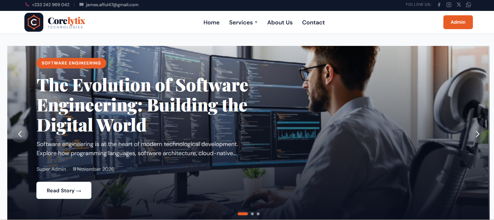
</p>

<p align="center">
  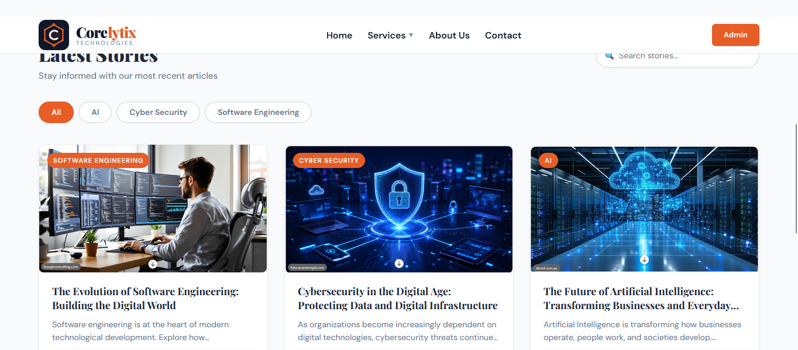
</p>

<p align="center">
  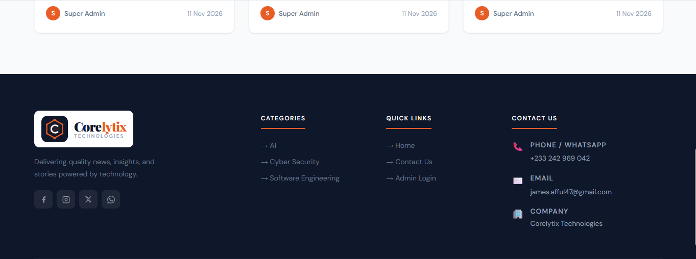
</p>

### Administrative Dashboard

The administrative interface provides authorised users with tools to manage website content and access protected CMS functionality.

| Administrator Login | Admin Dashboard |
|---|---|
| 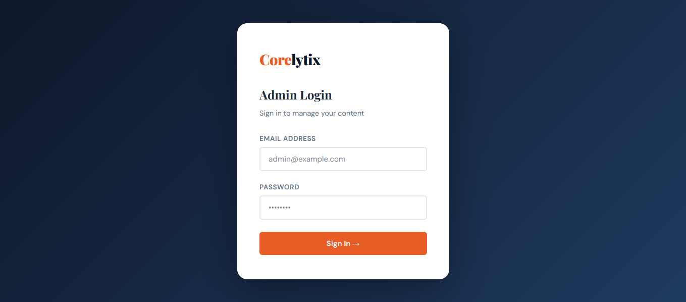 | 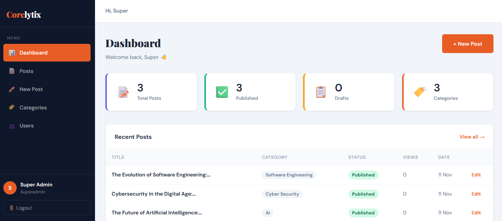 |

### Content and User Management

The CMS includes content creation and user profile management functionality.

| Post Management | User Profile |
|---|---|
| 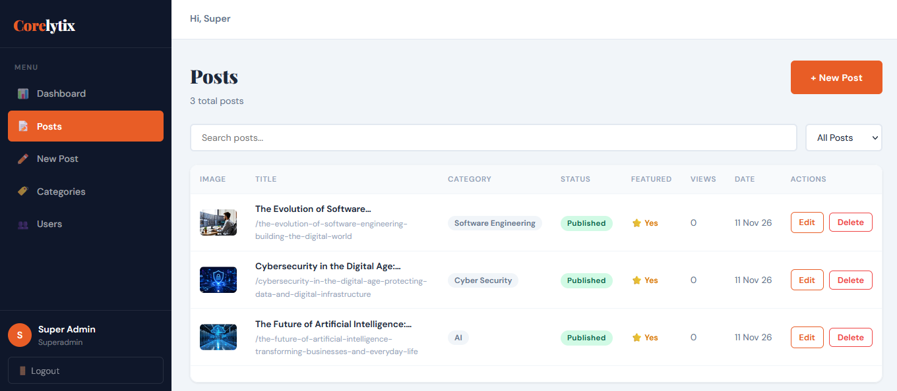 | 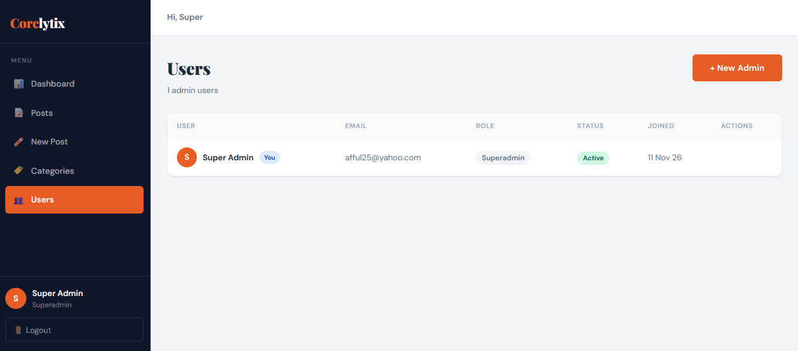 |

---

## AWS Cloud Infrastructure and Kubernetes Deployment

CMSPress is deployed on Amazon Elastic Kubernetes Service (EKS), using Docker containers, Kubernetes orchestration and AWS cloud infrastructure.

The following screenshots document the cloud deployment environment and supporting AWS services.

### Amazon EKS and Kubernetes

<p align="center">
  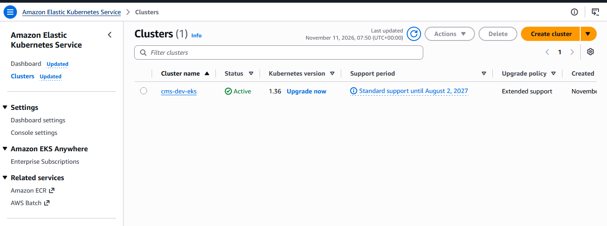
</p>

<p align="center">
  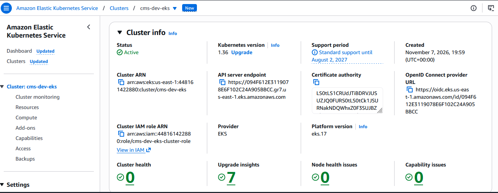
</p>

<p align="center">
  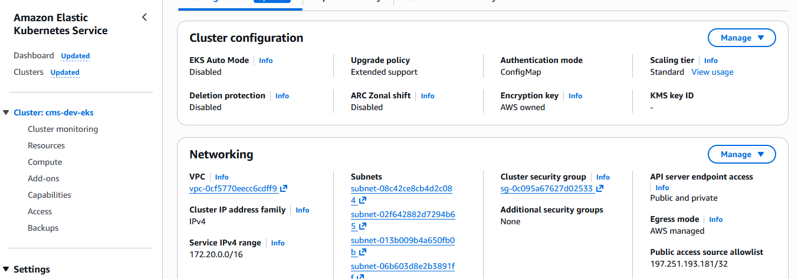
</p>

### Amazon Elastic Container Registry (ECR)

ECR stores the Docker container images used by the application deployment.

<p align="center">
  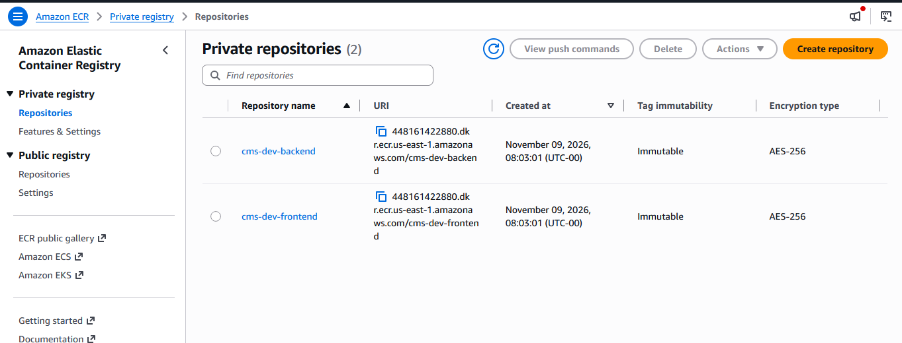
</p>

### Amazon RDS Database

Amazon RDS provides the managed MySQL database supporting the CMS application.

| RDS Configuration | RDS Database Details |
|---|---|
| 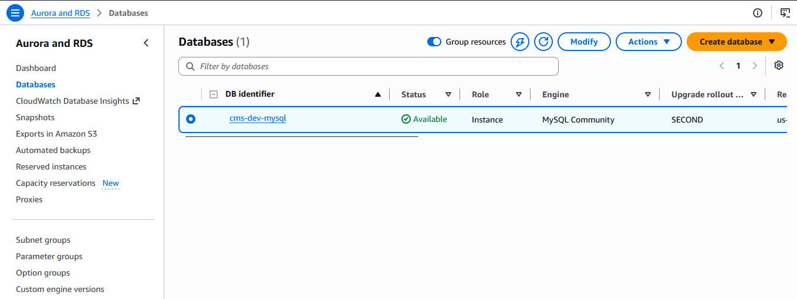 | 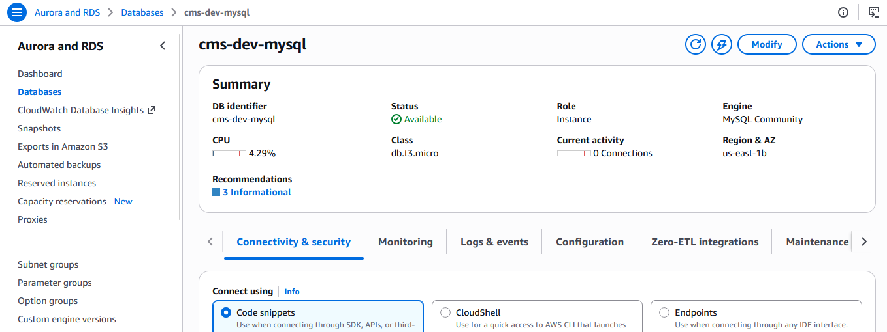 |

### AWS Networking and Security

The cloud environment incorporates VPC networking and AWS Secrets Manager for infrastructure connectivity and sensitive configuration management.

| VPC Networking | VPC Configuration |
|---|---|
| 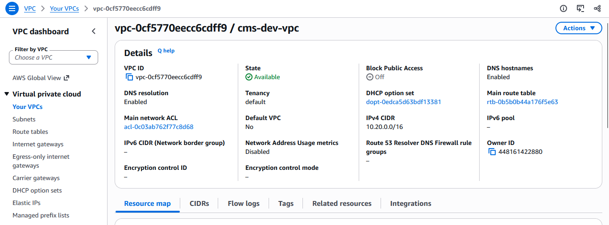 | 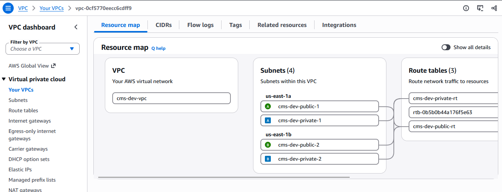 |

<p align="center">
  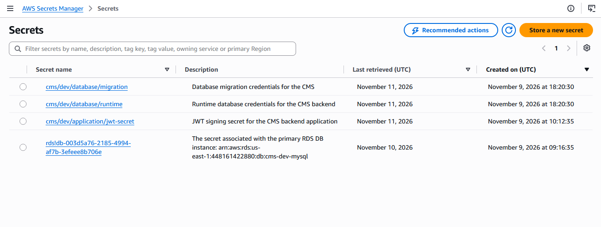
</p>

### Monitoring and Observability

Amazon CloudWatch provides monitoring and visibility into the deployed cloud environment.

<p align="center">
  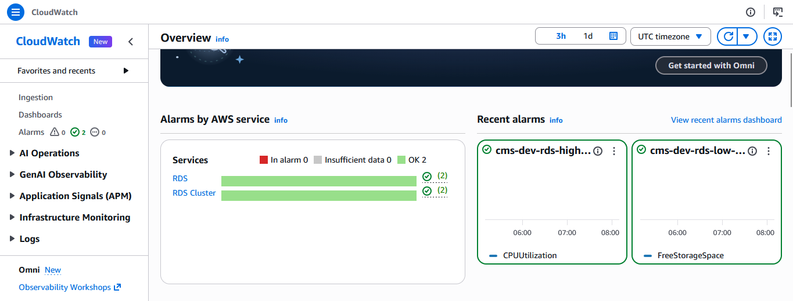
</p>

---

## CI/CD Pipeline and Deployment Automation

The project incorporates automated deployment workflows to streamline application build and deployment processes.

The following screenshots provide evidence of the CI/CD pipeline execution and its deployment stages.

<p align="center">
  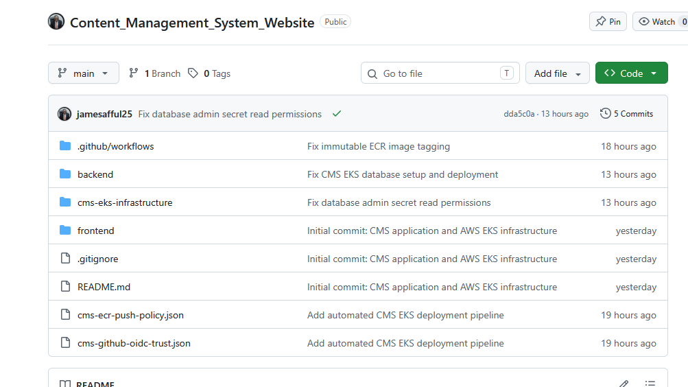
</p>

<p align="center">
  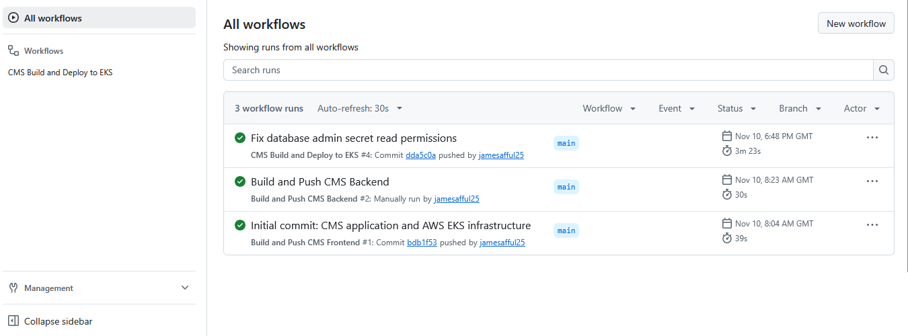
</p>

<p align="center">
  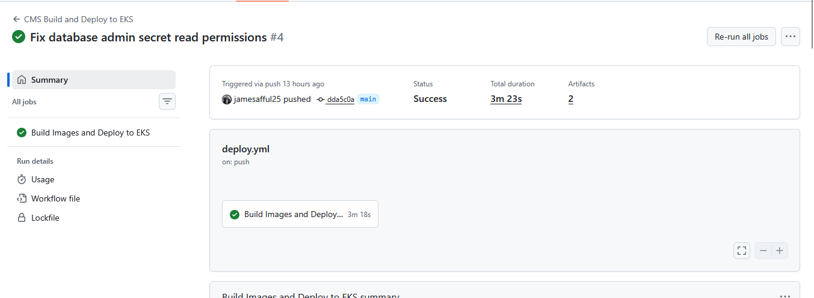
</p>

<p align="center">
  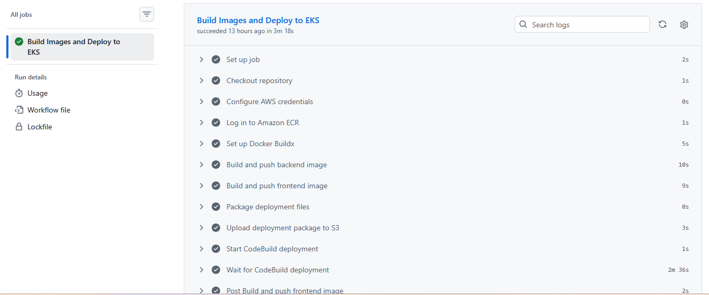
</p>

---

## Project Screenshots Summary

| Category | Screenshots | Description |
|---|---:|---|
| Application | 7 | Public website, authentication, administration and content management |
| AWS Infrastructure | 11 | EKS, ECR, RDS, VPC, Secrets Manager and CloudWatch |
| CI/CD | 4 | Automated build and deployment workflow evidence |
| **Total** | **22** | **Application and cloud deployment documentation** |


---
## Repository Structure
```text
Content_Management_System_Website/
│
├── .github/
│   └── workflows/
│
├── backend/
│   ├── config/
│   ├── controllers/
│   ├── middleware/
│   ├── migrations/
│   ├── models/
│   ├── routes/
│   ├── scripts/
│   ├── services/
│   ├── utils/
│   └── server.js
│
├── frontend/
│   └── src/
│       ├── api/
│       ├── components/
│       ├── context/
│       ├── hooks/
│       ├── pages/
│       └── styles/
│
├── cms-eks-infrastructure/
│   ├── modules/
│   ├── environments/
│   └── kubernetes/
│
├── docs/
│   └── screenshots/
│       ├── application/
│       │   ├── admin-dashboard.png
│       │   ├── admin-login.png
│       │   ├── admin-post.png
│       │   ├── mainpage-1.png
│       │   ├── mainpage-2.png
│       │   ├── mainpage-3.png
│       │   └── users-profile.png
│       │
│       ├── aws/
│       │   ├── cloudwatch.png
│       │   ├── cloudwatch1.png
│       │   ├── ecr.png
│       │   ├── eks.png
│       │   ├── eks1.png
│       │   ├── eks2.png
│       │   ├── rds1.png
│       │   ├── rds2.png
│       │   ├── secrets-manager.png
│       │   ├── vpc1.png
│       │   └── vpc2.png
│       │
│       └── cicd/
│           ├── cicd1.png
│           ├── cicd2.png
│           ├── cicd3.png
│           └── cicd4.png
│
├── cms-ecr-push-policy.json
├── cms-github-oidc-trust.json
├── .gitignore
└── README.md
```

---

## Local Development Setup

### Prerequisites

- Node.js and npm.
- MySQL.
- Git.
- A code editor such as Visual Studio Code.

### 1. Clone the Repository

```bash
git clone https://github.com/jamesafful25/Content_Management_System_Website.git

cd Content_Management_System_Website
```

### 2. Configure the Database

Create the local MySQL database:

```sql
CREATE DATABASE cms_db;
```

### 3. Configure the Backend

```bash
cd backend
npm install
```

Create a `.env` file based on the supplied `.env.example` file and configure the required database connection details, JWT secret and other application settings.

Start the backend:

```bash
npm run dev
```

### 4. Configure the Frontend

Open another terminal:

```bash
cd frontend
npm install
npm run dev
```

Open the local development URL displayed by Vite.

### 5. Create the Initial Super Administrator

The registration endpoint is restricted to an existing super administrator. Therefore, the initial administrator must be created using the project's supported database initialization or user setup process.

Use the provided database setup scripts and migration process where applicable. Configure credentials securely and avoid committing real passwords or secrets to source control.

---

## API Documentation

The backend exposes REST API endpoints for authentication, content management, categories and user administration.

### Authentication

| Method | Endpoint | Access |
|---|---|---|
| POST | `/api/auth/login` | Public |
| POST | `/api/auth/register` | Super Admin |
| GET | `/api/auth/profile` | Authenticated |
| PUT | `/api/auth/change-password` | Authenticated |

### Posts

| Method | Endpoint | Access |
|---|---|---|
| GET | `/api/posts` | Public |
| GET | `/api/posts/featured` | Public |
| GET | `/api/posts/slug/:slug` | Public |
| GET | `/api/posts/admin/all` | Author+ |
| POST | `/api/posts/admin` | Author+ |
| PUT | `/api/posts/admin/:id` | Author+ |
| DELETE | `/api/posts/admin/:id` | Editor+ |

### Categories

| Method | Endpoint | Access |
|---|---|---|
| GET | `/api/categories` | Public |
| POST | `/api/categories` | Editor+ |
| PUT | `/api/categories/:id` | Editor+ |
| DELETE | `/api/categories/:id` | Editor+ |

### Users

| Method | Endpoint | Access |
|---|---|---|
| GET | `/api/users` | Super Admin |
| PUT | `/api/users/:id` | Super Admin |
| DELETE | `/api/users/:id` | Super Admin |

---

## Administrative Roles and Permissions

| Role | Permissions |
|---|---|
| **Super Admin** | Full administrative access, including user, post and category management. |
| **Editor** | Manage posts, including deletion, and manage categories. |
| **Author** | Create and edit their own posts. |

Access to administrative operations is enforced through backend authentication and role-based authorization middleware.

---

## Engineering Skills Demonstrated

This project brings together several practical software engineering and cloud engineering disciplines:

- Full-stack web application development.
- React component architecture and frontend state management.
- REST API development using Node.js and Express.
- Relational database design and Sequelize ORM.
- JWT authentication and role-based authorization.
- Docker image creation and containerisation.
- Kubernetes application deployment and orchestration.
- AWS EKS and cloud infrastructure management.
- Amazon ECR container image management.
- Terraform and Infrastructure as Code.
- AWS IAM, Secrets Manager and cloud security.
- Automated application deployment and CI/CD.
- Cloud monitoring and operational troubleshooting.

---

## Future Improvements

Potential areas for further development include:

- Automated application and infrastructure testing.
- Enhanced observability and centralised application logging.
- Automated database backup and recovery procedures.
- Horizontal Pod Autoscaling.
- More comprehensive API documentation.
- Expanded content analytics and reporting.
- Automated security and container vulnerability scanning.

---

## Author

**James Afful**

Full-Stack Developer | DevOps & Cloud Engineer | AI Automation Engineer | Data Scientist & Analytics | Economist & Financial Analyst

- **GitHub:** [jamesafful25](https://github.com/jamesafful25)
- **Portfolio:** [jamesafful25.github.io/james-afful-portfolio](https://jamesafful25.github.io/james-afful-portfolio/)
- **Email:** james.afful47@gmail.com

---

## License

This project is available for learning, demonstration and portfolio purposes. Add a formal license file if you intend to grant specific reuse or distribution permissions.
